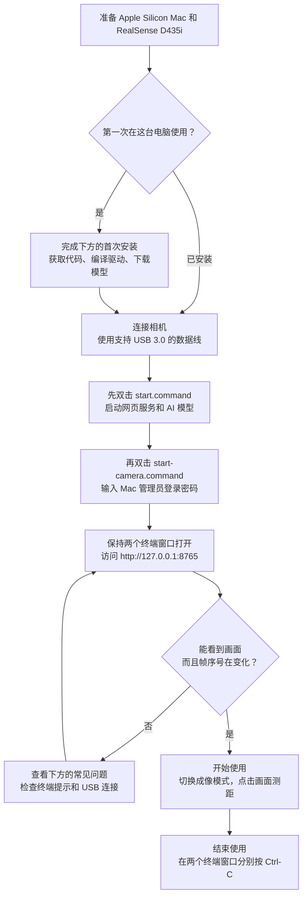
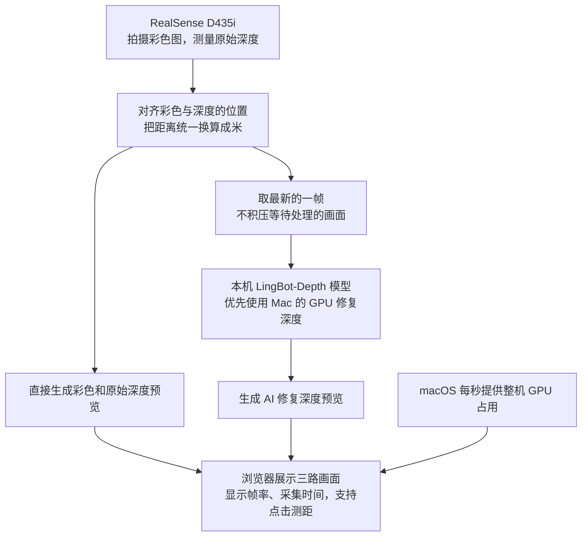

# RealSense + 蚂蚁灵波实时深度预览

本地采集 RealSense D435i 的 RGB 和深度，使用蚂蚁灵波官方 **LingBot-Depth v0.5** 修复深度。
浏览器同时显示彩色、原始深度、模型修复深度，点击画面可查看该位置的米制距离。

## 新手先看：从安装到看到画面

已经安装好的电脑，从图中的「连接相机」开始即可。第一次使用，请先完成[首次安装](#首次安装只做一次)。



## 日常启动：按这个顺序做

1. **连接相机。** 使用 USB 3.0 数据线连接 D435i，把相机对准约 0.3 米以外的物体，保持双目镜头无遮挡。
2. **先打开网页服务。** 在项目文件夹里双击 `start.command`。它会打开第一个终端窗口，并尝试自动打开浏览器；保留这个终端窗口。
3. **再打开相机采集。** 双击 `start-camera.command`。在第二个终端窗口出现 `Password:` 时，输入 **Mac 管理员登录密码**，然后按回车。输入时不会显示字符或星号，这是正常的。
4. **查看实时画面。** 浏览器打开 <http://127.0.0.1:8765>。先等待相机连接，再等待 AI 首帧完成；页面应显示彩色、原始深度和灵波修复深度。画面下方的帧序号和采集时间持续变化，才表示正在更新。
5. **选择效果。** 先用「快速预览」；想看更多细节，再试「均衡」或「细节」。点击画面可读距离，右上角可看各路 FPS，顶部可看整机 GPU 占用。

两个脚本都要运行，顺序是 **`start.command` → `start-camera.command`**。也可以在项目目录的终端中依次执行 `./start.command` 和 `./start-camera.command`，每个脚本使用一个终端窗口。

**如何停止：** 先在相机采集终端按 **Ctrl-C**，再在网页服务终端按 **Ctrl-C**。只关闭浏览器标签页不会停止相机和 AI。

只有 USB 采集进程（`camera_runner.py` 及其子进程 `camera_capture.py`）需要管理员身份；模型与网页服务以普通用户身份运行。
采集进程仍在运行时，USB 超时或拔插会自动重连；终端关闭或服务退出后需重新启动。重复运行采集脚本会被进程锁阻止，避免争用相机。
服务仅监听 `127.0.0.1`；画面在本机内存中传递，默认不录制、不上传。

## 程序里面发生了什么

相机同时提供彩色和距离信息。程序把二者对齐后，一路直接显示，另一路交给本机 AI 修复深度；相机持续取新画面，AI 每次处理最新的一帧。



彩色和原始深度采集通常约 **30 FPS**，本机 AI 快速模式实测约 **2–4 FPS**，因此 AI 画面会稍晚更新。它们都在本机处理，速度以页面显示为准。

每幅画面右上角显示帧率：彩色和原始深度为采集 FPS，AI 为推理结果更新 FPS；画面中断时归零。性能栏还显示 Apple M4 的整机 GPU 利用率，每秒从 macOS IORegistry 采样一次，无需管理员权限，包含其他应用的 GPU 负载。指标缺失或过期时显示不可用，不使用估算值。

LingBot-Depth 的代码与本项目使用的 v0.5 权重均标注 Apache 2.0。推理在本机 M4 / Metal 上运行，不调用在线模型 API，不消耗 API 计费 token。配置中的 tokens 是图像分块数量，用于控制细节和速度；首次安装联网下载权重，运行时使用本地文件。

## 遇到问题怎么办

| 你看到的情况 | 先这样处理 |
| --- | --- |
| 网页打不开 | 先运行 `start.command`，确认对应终端没有退出，再访问上面的本机地址。 |
| 网页打开了，一直「等待相机」 | 再运行 `start-camera.command`，完成密码验证；检查 USB 数据线和相机连接。 |
| 输入密码时屏幕没有反应 | 密码不会显示出来；正常输入完整密码后按回车，不要把密码发给其他人。 |
| 原始深度大片黑色 | 黑色表示没有测到有效距离。把物体放在约 0.3 米以外，检查镜头遮挡，换一个有纹理、不过度反光的目标。 |
| AI 画面比彩色画面慢 | AI 是异步计算的。选「快速预览」，观察 AI 的 FPS 和输入时间。 |
| 显示「画面已中断／正在重连」 | 保持两个终端打开，等待自动重连；若终端已退出，重新运行对应脚本。持续失败时查看终端报错和[驱动构建说明](docs/realsense-macos-build.md)。 |
| 关闭网页后 GPU 仍有占用 | 程序仍可能在后台运行；在两个终端分别按 Ctrl-C。页面里的 GPU 占用也包含其他应用。 |

## 实际速度与限制

2026-11-17 在本机 MacBook Air M4 / 16 GB / PyTorch 2.6.0 上验证了官方 640×480 样例：

- 1200 tokens、MPS（Metal）、FP32：首轮约 4.79 秒，第二轮约 **1.59 秒 / 帧**。
- CPU 同配置：约 **4.14 秒 / 帧**。
- 快速预览（256 tokens）：预热后两次计时中位数 **0.233 秒 / 帧，约 4.29 FPS**。
- 均衡模式（512 tokens）：同条件 **0.526 秒 / 帧，约 1.90 FPS**。
- 程序默认快速预览，可在页面切换为均衡或细节（1200 tokens）。快速/均衡低于官方默认 1200–3600 token 范围，可能损失边缘和细节，尚未验证实拍精度。
- 这些是官方静态样例的推理测试，不能当作实际相机吞吐量或精度保证。
- 相机请求 640×480 @ 30 FPS；真实采集帧率以界面实测为准，浏览器预览上限约 15 FPS。
- AI 采用“处理完后取最新一帧”，不会积压视频。AI 与原始深度可能来自不同时间，界面分别显示结果更新时间与输入年龄。
- ViT-L 模型在此 Mac 的默认配置不具备 30 FPS 实时修复能力。若需要逐帧实时 AI，应在 NVIDIA GPU 上测量 CUDA 部署性能。
- 点击测距读取当前最新原始/模型深度，并非冻结所点的历史画面。模型输出是估计值，不能替代经标定的传感器精度验证。

**实拍已验证**：升级到下述 SDK 2.59.2 后，D435i 彩色+对齐深度持续输入约 30 FPS，LingBot 快速模式实测约 2–4 FPS（随系统负载变化）。连续运行超过 3 分钟无采集/模型错误；一次 5 秒观测新增 151 个相机帧、16 个 AI 结果。初始相机朝向下原始深度有效比例约 1–2%，界面会提示调整距离和遮挡；这一场景的 AI 距离只适合作为预览，尚未验证测量精度。

长时间运行中曾出现 USB 取帧超时。现已修复：超过 3 秒的相机旧图不再作为实时帧返回，页面隐藏旧图、帧率归零、清空旧测距，AI 采用适应推理速度的过期时间。页面显示真实帧序号和采集时刻。采集超时会重建采集进程，以 2–15 秒退避自动重连；原生驱动短时间连续崩溃三次则停止重试并明确报错。已通过暂停真实采集进程、验证旧图 503、恢复以及强制结束采集子进程后自动重新启动的硬件测试；12 项自动化测试通过。

## Mac 兼容方案

官方主要面向 CUDA。本项目使用原生 PyTorch SDPA，设置 `enable_depth_mask=False`，不安装 xFormers。关闭 depth-token masking 会改变缺失深度区域的处理路径，效果需用实际场景评估。

PyTorch 2.6 尚不支持 MPS 的抗锯齿双线性缩放，本项目启用 `PYTORCH_ENABLE_MPS_FALLBACK=1`，仅不支持的算子回落 CPU，Transformer 仍在 MPS 运行。若其余 MPS 操作报错，适配器会明确记录原因并回落整个模型到 CPU。

深度通过 SDK `rs.align(rs.stream.color)` 对齐到彩色画面，原始 Z16 值乘设备实际 `depth_scale` 转米。相机内参来自彩色流，按宽高归一化后传给模型。黑色表示无效深度；所有深度图使用相同 0.2–4.0 米 TURBO 色标，超出范围的有效值只在显示时截到色标端点。

## 文件说明

- `app.py`：本机 HTTP 服务、画面接收、异步推理、测距。
- `camera_capture.py`：USB 采集，仅经权限为 0600 的 Unix socket 发送 RGB-D 数据。
- `camera_runner.py`：监测采集退出、自动重连并报告具体错误；单实例进程锁避免重复占用设备。
- `lingbot_worker.py`：LingBot 模型加载、MPS/CPU 适配和离线基准测试。
- `index.html`：无外部网络依赖的预览界面。
- `models/lingbot-depth-v0.5/model.pt`：官方权重（1,284,837,952 bytes），本机已下载，Git 仓库不包含权重。
- `vendor/lingbot-depth`：官方仓库子模块，固定提交 `f3a237e434ae987bc38281476d6cfb5df3e4d739`；版权和许可见其 LICENSE / LEGAL.md。
- `output/official-example-*.npz` 与 JSON：本地生成的官方样例输入、真实预测和计时，**不是相机实拍**，也不提交到 Git。

## 首次安装（只做一次）

需要 **Apple Silicon Mac、macOS 15 或更新版本、Python 3.12、Xcode Command Line Tools**。可以用 `xcode-select --install` 安装苹果命令行工具；执行 `python3.12 --version` 应能显示 Python 3.12 的版本号。首次安装需要联网，会编译相机驱动并下载约 1.28 GB 的模型。

打开「终端」，进入你准备存放项目的位置，按顺序运行下面的命令。**使用 Git 克隆，不要只下载 GitHub 的 ZIP**，因为项目还依赖 LingBot 子模块。

```bash
git clone --recurse-submodules https://github.com/FrankJIE09/realsense_mayi.git
cd realsense_mayi
python3.12 -m venv .venv
# 编译 SDK wheel；仓库不包含平台相关二进制产物。
bash scripts/build-realsense-macos.sh
.venv/bin/python -m pip install -r requirements.txt
.venv/bin/python -c "from huggingface_hub import hf_hub_download; hf_hub_download('robbyant/lingbot-depth-pretrain-vitl-14-v0.5', 'model.pt', local_dir='models/lingbot-depth-v0.5')"
```

如果已经克隆项目但缺少 `vendor/lingbot-depth` 中的文件，进入项目目录运行 `git submodule update --init --recursive`，然后从创建虚拟环境开始安装。现有 `build/wheels` 中有匹配 wheel 时可跳过编译。不要直接安装官方 requirements：其 xFormers/CUDA 依赖不适用于此 Mac。

安装完成后，回到上面的[日常启动步骤](#日常启动按这个顺序做)；以后使用不必重复安装。

## 离线验证与开发检查

```bash
# 只预览相机，不加载模型
# 此命令运行后，另开一个终端执行 ./start-camera.command 启动相机
.venv/bin/python app.py --no-ai

# 生成官方样例输入，再离线验证
.venv/bin/python scripts/prepare-example.py
.venv/bin/python lingbot_worker.py \
  --input output/official-example-input.npz \
  --output output/check.npz \
  --model models/lingbot-depth-v0.5/model.pt \
  --device auto --tokens 1200 --warmup 1 --runs 2

# 测试传输、米制转换、测距接口和无效输入
.venv/bin/python -m unittest discover -s tests -v
```

## 参考

- 官方模型：<https://github.com/Robbyant/lingbot-depth>
- 官方权重：<https://huggingface.co/robbyant/lingbot-depth-pretrain-vitl-14-v0.5>
- Mac RealSense wheel：<https://github.com/cansik/pyrealsense2-macosx>
- 官方 macOS USB 权限说明：<https://github.com/realsenseai/librealsense/blob/master/doc/installation_osx.md>

本机原先的社区 SDK 2.56.5 已实测在管理员权限下因 `IOHIDDeviceOpen` 发生 SIGSEGV。现已改用官方源码 **librealsense 2.59.2 + libusb 1.0.29**，HID 改走 libusb 路径，真实相机验证通过。没有修改固件或系统安全设置。

修复后的 wheel 在 `build/wheels/pyrealsense2_macosx-2.59.2-cp312-cp312-macosx_15_0_arm64.whl`，`requirements.txt` 会从本地安装；不依赖 Homebrew。适用于 Python 3.12、macOS 15+、arm64。不要降级回 PyPI 的旧 2.56.5。

```bash
# 需要重新构建 wheel 时（无需 sudo；首次编译需要几分钟）
bash scripts/build-realsense-macos.sh
.venv/bin/python -m pip install -r requirements.txt
```

构建过程和源码版本见 [构建记录](docs/realsense-macos-build.md)，可复现脚本为 `scripts/build-realsense-macos.sh`。
